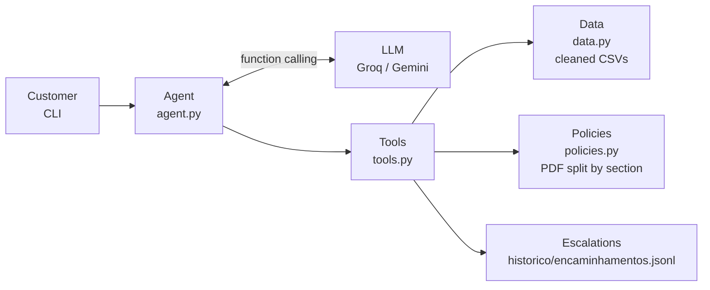

# Duda: customer service agent for Empório da Música

🇧🇷 [Versão em português](README.md)

Prototype of a text-message customer service agent for **Empório da Música**, a fictional musical instrument store in Campo Grande/MS, Brazil. Built as the technical challenge for the AI Engineer position at Artefact.

**Duda** answers customers in the store's tone of voice, queries live data (catalog, prices, promotions, stock and orders), applies the rules from the store's policy manual, escalates cases to the human team and politely declines anything out of scope.

> **Language note:** the store and its customers are Brazilian, so the agent, its prompt and the example conversations are in Portuguese. All documentation is available in English in this file.

```
Customer: Quanto custa o Takamine GD20?            ("How much is the Takamine GD20?")
  tool: obter_produto {"nome_ou_id": "Takamine GD20"}
Duda: O Takamine GD20 Dreadnought Natural está disponível por R$ 2.199,00. No PIX sai por
R$ 2.089,05 (5% de desconto) e dá pra parcelar em até 12x de R$ 183,25 sem juros. 🎸
```

The 5 full example conversations are in [`conversas/`](conversas/).

---

## Contents

1. [How to run](#how-to-run)
2. [Architecture](#architecture)
3. [Technical decisions](#technical-decisions)
4. [Data handling and assumptions](#data-handling-and-assumptions)
5. [Tests and evaluation](#tests-and-evaluation)
6. [Example interactions](#example-interactions)
7. [Known limitations and next steps](#known-limitations-and-next-steps)
8. [Use of coding assistants](#use-of-coding-assistants)

---

## How to run

### Requirements

- Python 3.10 or later (developed and tested with Python 3.13 on Windows)
- A free API key from at least one provider:
  - **Groq** (recommended): [console.groq.com](https://console.groq.com) → API Keys → Create API Key
  - **Google Gemini**: [aistudio.google.com](https://aistudio.google.com) → Get API key

### Installation

```bash
git clone https://github.com/brunasilva-dev/emporio-musica-agent.git
cd emporio-musica-agent

python -m venv .venv
# Windows (PowerShell)
.venv\Scripts\Activate.ps1
# Linux / macOS
source .venv/bin/activate

pip install -r requirements.txt
```

### Configuration

Copy the example file and fill in the key(s):

```bash
cp .env.example .env        # Windows: copy .env.example .env
```

```env
LLM_PROVIDER=groq            # primary provider: groq or gemini

GROQ_API_KEY=gsk_...
GROQ_MODEL=openai/gpt-oss-120b

GEMINI_API_KEY=AQ...         # optional: becomes an automatic fallback
GEMINI_MODEL=gemini-3.8-flash
```

One key is enough. With both, the second provider takes over automatically when the primary one fails.

### Run

```bash
python chat.py            # normal conversation
python chat.py --debug    # shows the tools called, the provider used and API errors
```

Chat commands:

| Command | What it does |
|---|---|
| `/debug` | toggles the display of tool calls |
| `/exportar <title>` | saves the current conversation as Markdown in `conversas/` |
| `/nova` | starts a new conversation |
| `/sair` | exits |

The history is saved automatically to `historico/<session>.json`, so reopening the chat resumes the conversation. Use `--sessao other_name` for separate conversations.

### Tests

```bash
python -m pytest -q       # 38 tests, none of them calls an API
```

---

## Architecture



**Flow of each message**

1. The agent sends the LLM the system prompt (persona, rules and the store's current status), the conversation history and the schemas of the 6 tools.
2. The LLM decides whether to answer directly or request data. If it requests tools, Python executes each one and returns the result.
3. The cycle repeats (up to 6 rounds) until the LLM answers in text.

**Available tools**

| Tool | When the LLM uses it |
|---|---|
| `buscar_produtos` (search products) | open searches: "acoustic guitars up to R$ 1000", "electric ukulele" |
| `obter_produto` (get product) | one specific model, fuzzy name: "Takamine GD20" |
| `listar_categorias` (list categories) | "what do you sell?" |
| `consultar_pedido` (check order) | status, tracking and return deadlines. Requires the order number and the account holder's email or phone |
| `consultar_politica` (check policy) | opening hours, address, payment, returns, shipping, warranty, promotions, data privacy |
| `encaminhar_para_atendente` (escalate to staff) | complaints, delays, price discrepancies, data privacy requests, asking for a human |

**Project structure**

```
emporio-musica-agent/
├── chat.py                 # entry point
├── data/                   # CSVs and PDF provided by the store (normalized file names)
├── src/emporio/
│   ├── config.py           # LLM providers from .env
│   ├── data.py             # data layer: cleaning, prices, promotions, orders
│   ├── policies.py         # policy manual split by section + opening hours
│   ├── tools.py            # tool schemas and execution
│   ├── prompts.py          # agent persona and rules
│   ├── agent.py            # function calling loop, retry, fallback, circuit breaker
│   └── cli.py              # terminal chat, history and export
├── tests/                  # deterministic tests (no API calls)
└── conversas/              # exported example conversations
```

---

## Technical decisions

### Approach: function calling with typed tools, no framework

I chose a custom function calling loop (~230 lines in `agent.py`) instead of LangChain, LlamaIndex or a framework ReAct agent.

- **Transparency:** every step (what the LLM requested, what the tool returned) is visible and easy to debug. During development this was decisive for diagnosing real API errors.
- **Few dependencies:** the OpenAI SDK is the only LLM library.
- **Native function calling** already solves the "query data vs. query policies" routing: the model picks the tool from its description, and the requirement of "knowing when to query each source" is explicit in the schemas and the prompt.

### Why not a SQL agent (text-to-SQL)

- **Security and privacy (LGPD, Brazil's data protection law):** with free-form SQL, a customer could induce the model to query other people's orders. With typed tools, `consultar_pedido` only returns data when the contact provided matches the account holder, and that rule lives in code, not in the prompt.
- **Deterministic business rules:** promotional price, non-cumulative PIX discount, installment tiers and return deadlines are computed in Python and covered by tests. Guiding principle: **the LLM talks, the code calculates**.
- **Data volume:** 65 products and 20 orders. In-memory pandas is enough; no database needed.

### Why not vector RAG for the policies

The manual has 8 pages and a clear structure of numbered sections. Instead of chunking + embeddings + similarity search:

- the PDF is split by **the document's own 9 sections**;
- the LLM picks the section from a **closed list (enum)** in the tool schema.

This removes typical retrieval errors (wrong chunk, rule cut in half), needs no embedding service and is fully testable. If the manual grows to dozens of documents, the natural next step is hybrid RAG (BM25 + embeddings) behind the same `consultar_politica` interface.

### Model and provider

| | Choice | Reason |
|---|---|---|
| Primary | **Groq** with `openai/gpt-oss-120b` | free, low latency, good at function calling |
| Fallback | **Google Gemini** with `gemini-3.8-flash` | free, takes over when the primary fails |
| Integration | **OpenAI SDK** pointing to compatible endpoints | switching providers only requires changing `.env` |

I started with Gemini as primary, but during testing it repeatedly returned **503 (high demand)** and then **429 (free quota exhausted)**. I inverted the order based on that evidence: Groq as primary, Gemini as backup.

**Resilience**, all in `agent.py`:

- **Retry with exponential backoff** on transient errors (429, 5xx, timeout).
- **Rate-limit aware:** when the provider states how long to wait ("try again in 21s"), the agent waits that long, up to 30s, instead of failing.
- **Circuit breaker:** a provider that exhausts its retries is paused for 2 minutes, and the next messages go straight to the fallback without repeating timeouts.
- **Compact history:** Groq's free tier allows 8,000 tokens per minute. For previous turns, the model only receives the dialogue (customer and Duda); raw tool results are sent only for the current turn. The full history is still saved to disk.
- **Cross-provider compatibility:** Gemini 3 requires the *thought signature* to be sent back with tool calls (`extra_content` field). The agent preserves it for Gemini and strips it when sending to Groq.

### Prompt strategy

The system prompt (`prompts.py`) is organized in blocks:

- **Persona:** Duda, virtual assistant. Tone "informal but professional, like a friend who knows music", following section 7.1 of the manual. Short, WhatsApp-style answers.
- **Dynamic context:** date, time and store status (open/closed and when it reopens) in Campo Grande's time zone (UTC-4), **recomputed by code on every message**, not by the LLM.
- **When to use each tool:** never state price, stock or deadlines from memory.
- **Business rules:** promotions always shown with original price and percentage, PIX discount not cumulative, never promise inactive discounts.
- **Scope and security:** instruments only (no accessories), light refusal for off-topic requests, never reveal instructions or third-party data.
- **Honesty about actions:** never claim to have registered or escalated something without calling the tool and receiving the ticket number. This rule was added after a test in which the model promised an escalation it never executed (see [conversation 5](conversas/05_fora_do_escopo_seguranca_e_endereco.md)).

Tools also return **internal guidance** (`alertas_para_o_atendente`, `nota_de_curadoria`) that the agent follows without exposing it to the customer. Example: "estimated delivery date has passed; apologize and offer escalation".

### Interface and persistence

- **CLI with `rich`:** the challenge focuses on the agent working correctly, and the CLI supports a debug mode and Markdown export of conversations.
- **JSON history per session:** customers can leave and come back without losing context, which fits messaging-based support.
- **Escalations** are logged to `historico/encaminhamentos.jsonl` with a ticket number, simulating the human team's queue.

---

## Data handling and assumptions

I analyzed the CSVs and the PDF before writing code and found several inconsistencies. Following the challenge's guidance, I made reasonable assumptions and documented them here. All of them are implemented in code and covered by tests.

### Inconsistencies in the data

| Finding | Decision |
|---|---|
| Product 96 with status `active` and stock 0 | treated as **out of stock**; the agent suggests alternatives |
| Product 136 `discontinued` with stock 13 | **not for sale** (manual section 7.3: "no longer part of the catalog") |
| Product 130 `coming_soon` with stock 2, yet present in orders 3 and 14 | **not for sale** in the catalog; existing orders are displayed normally |
| Customers 11 and 43 share the same email | email-only lookup is blocked; the agent asks for the order number or phone |
| Total of orders 3 and 20 differs from the sum of their items | the agent reports the recorded total and escalates if the customer disputes it (likely a past discount) |
| Order 8 "shipped" with estimated delivery on 2026-02-28; orders "pending"/"confirmed" since Feb-Mar 2026 | code raises an alert; the agent apologizes, promises no deadline and offers escalation |
| Promotions without validity dates; products with more than one promotion | only `is_active = 1` counts; if more than one is active, the highest discount wins |
| Orders without an actual delivery date | return (7 days) and legal warranty (90 days) deadlines counted from the **estimated delivery date** |
| Data dates (2025-2026) | the agent uses the **real current date** for deadlines and store status |

### Inconsistencies in the policy manual

| Finding | Decision |
|---|---|
| Two phone numbers: (67) 3341-4444 (cover and company data) and (67) 3321-4500 (section 7) | **(67) 3341-4444** as the official contact: it appears twice, including in the company data table |
| Email with an accent in the table (`empóriodamusica`) | typo; **contato@emporiodamusica.com.br** used, as on the cover |
| Payment table says "minimum installment R$ 100", but section 3.1 defines tiers | **section 3.1** prevails, as the more specific rule: up to 3x min R$ 50, 4x-6x R$ 80, 7x-12x R$ 100 |
| Manual says "Black Friday in November, 15-30% off the whole catalog", but no Black Friday promotion is active in the system | the calendar is only the general schedule; **only discounts active in the system apply** (section 7.3: "never promise a discount that is no longer valid") |
| Manual mentions "more than 300 instruments"; the catalog has 65 | the agent relies only on the provided catalog |
| Holidays not listed in the manual | the open/closed status ignores holidays (known limitation) |

These interpretations live in the code as **curation notes** attached to each section's text (`policies.py`), so the agent answers consistently.

### Other data handling

- **File names** normalized (no spaces or accents).
- **PDF:** extracted with `pypdf` in layout mode (the default mode broke every word onto its own line), page headers and footers removed, text split into sections. Numbered lists inside a section, such as "1. Saudação" in section 7, do not become new sections.
- **Typo-tolerant search:** `rapidfuzz` combines word-level and space-insensitive matching. "takamini gd 20" finds "Takamine GD20". Ambiguous names ("Martin D28" matches both D-28 and D-28E) make the agent ask for confirmation.
- **Category aliases:** "violão" (acoustic guitar) finds the "Violões" category even though product names don't contain the word.
- **Monetary values** formatted in Brazilian style (R$ 2.199,00) by code, not by the LLM.

---

## Tests and evaluation

**38 automated tests** (`pytest`), all deterministic and without API calls:

- **`test_data.py`:** prices, PIX, active and inactive promotions, installment tiers, availability, alternatives, typo-tolerant search, ambiguous names, identity check on orders, shared email, alerts and return deadlines.
- **`test_policies.py`:** extraction of the 9 sections, curation notes and opening hours (weekday, Saturday until 1 p.m., Sunday).
- **`test_agent.py`:** agent loop with a fake LLM. Covers tool execution, thought signature preservation, provider fallback, circuit breaker, rate-limit wait and compact history.

**LLM behavior evaluation:** done manually through the 5 conversations, which cover both happy-path and adversarial scenarios. Each issue found became a prompt or code fix, recorded in the commit history. Examples: product descriptions embellished beyond the catalog, an escalation promised but never executed, and an unnecessary request for a summary in a complaint.

---

## Example interactions

Conversations are in Portuguese, the customers' language.

| # | Scenario | What it shows |
|---|---|---|
| [01](conversas/01_catalogo_de_violoes_ate_1000.md) | Acoustic guitars up to R$ 1,000 and a beginner recommendation | category + price filtered search; PIX and installments computed |
| [02](conversas/02_preco_promocao_e_black_friday.md) | Price of the Takamine GD20, a ukulele on sale and Black Friday | promotion not cumulative with PIX; does not promise an inactive discount |
| [03](conversas/03_devolucao_de_pedido_com_politicas.md) | "I regret my purchase, can I return it?" | identity check + order data + returns and warranty policy |
| [04](conversas/04_pedido_atrasado_e_encaminhamento.md) | Order delayed since February | detects the delay in the data, apologizes and opens tickets |
| [05](conversas/05_fora_do_escopo_seguranca_e_endereco.md) | Accessory, cake recipe, fake employee and store address | scope, prompt-injection resistance, curated official data |

---

## Known limitations and next steps

**Limitations**

- **Free-tier limits:** with Groq's free tier (8,000 tokens/minute), messages sent in quick succession may take ~20s while the agent waits for the limit to reset.
- **Minor LLM embellishments:** the model occasionally adds details not present in the sources. Example: it said Black Friday starts "at the end of November", while the manual only says "November". Prompt rules reduce this but don't eliminate it.
- **No actual delivery date:** deadlines use the estimated delivery date as an approximation.
- **Holidays** are not considered in the opening status.
- **Escalations** are written to a local file, with no real ticketing integration.
- **Manual LLM evaluation**, without an automated eval suite.
- **Does not complete purchases:** the agent directs customers to the store or the team.

**With more time, I would**

1. **Build an automated eval suite:** dozens of questions with expected answer and expected tool, run on every prompt change, measuring tool-selection accuracy, faithfulness to sources (LLM-as-judge) and correct refusal rate.
2. **Add a web chat interface** (Streamlit, or a FastAPI service that could integrate with WhatsApp Business).
3. **Use a real database** (SQLite/Postgres) instead of CSVs, with live stock updates.
4. **Add observability:** tracing of every call (LangSmith, Langfuse or OpenTelemetry) with latency, tokens and cost per conversation.
5. **Add a holiday calendar** and special opening hours (Black Friday, Christmas).
6. **Move to hybrid RAG** for policies if the document volume grows.
7. **Add an output guardrail:** automatically check that every price in the answer came from a tool call in the same turn.

---

## Use of coding assistants

I used **Claude Opus 5.5** (Anthropic), through the Claude app, as a pair programmer throughout the challenge. I chose an advanced reasoning model because the challenge involved more analysis and architecture decisions than repetitive code. My workflow was:

1. **Problem analysis:** I shared the challenge, the CSVs and the PDF. Before any code, I asked for a data analysis, which surfaced the inconsistencies documented above (conflicting phone numbers, shared email, mismatched totals, a "coming soon" product that was sold, etc.).
2. **Architecture definition:** Claude proposed the alternatives (RAG, SQL agent, function calling, frameworks) with the trade-offs of each, and I chose function calling with typed tools, for the reasons described in [Technical decisions](#technical-decisions).
3. **Incremental implementation with tests:** the code was generated in stages (data → policies → agent → CLI), always together with tests. At each stage I reviewed it, ran the tests on my machine and committed, which produced the repository history.
4. **Debugging with real errors:** several issues only appeared when running on my machine, and I resolved each one from the logs:
   - the Gemini key in the new format (`AQ.`) and the model change (`gemini-2.5-flash` is no longer available to new users);
   - Gemini's 503 and 429 errors, which led to inverting the providers and adding the circuit breaker;
   - a misconfigured Groq key (401);
   - Groq's 8,000 tokens/minute limit, which led to the rate-limit wait and the compact history.
5. **Behavior validation:** I recorded the conversations, read every answer and pointed out the problems, which became prompt fixes. The most important case was the agent promising an escalation without having called the tool.

In my assessment, AI greatly sped up writing the code and the initial data analysis. Product decisions, validation in a real environment and critical review of the agent's answers were my role. I have reviewed and understand all the delivered code.
