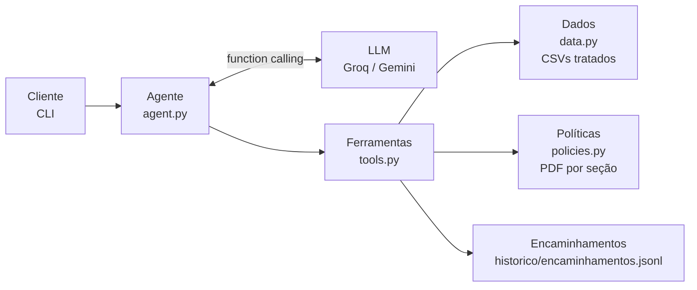

# Duda: agente de atendimento da Empório da Música

🇺🇸 [English version](README.en.md)

Protótipo de agente de atendimento por mensagens de texto para a **Empório da Música**, loja fictícia de instrumentos musicais em Campo Grande/MS. Desenvolvido como desafio técnico para a vaga de AI Engineer da Artefact.

A **Duda** responde clientes no tom da loja, consulta dados em tempo real (catálogo, preços, promoções, estoque e pedidos), aplica as regras do manual de políticas, encaminha casos para a equipe humana e recusa com educação o que está fora do escopo.

```
Você: Quanto custa o Takamine GD20?
  ferramenta: obter_produto {"nome_ou_id": "Takamine GD20"}
Duda: O Takamine GD20 Dreadnought Natural está disponível por R$ 2.199,00. No PIX sai por
R$ 2.089,05 (5% de desconto) e dá pra parcelar em até 12x de R$ 183,25 sem juros. 🎸
```

As 5 conversas completas estão em [`conversas/`](conversas/).

---

## Sumário

1. [Como rodar](#como-rodar)
2. [Arquitetura](#arquitetura)
3. [Decisões técnicas](#decisões-técnicas)
4. [Tratamento de dados e suposições](#tratamento-de-dados-e-suposições)
5. [Testes e avaliação](#testes-e-avaliação)
6. [Exemplos de interação](#exemplos-de-interação)
7. [Limitações conhecidas e próximos passos](#limitações-conhecidas-e-próximos-passos)
8. [Uso de assistentes de código](#uso-de-assistentes-de-código)

---

## Como rodar

### Pré-requisitos

- Python 3.10 ou superior (desenvolvido e testado com Python 3.13 no Windows)
- Uma chave de API gratuita de pelo menos um provedor:
  - **Groq** (recomendado): [console.groq.com](https://console.groq.com) → API Keys → Create API Key
  - **Google Gemini**: [aistudio.google.com](https://aistudio.google.com) → Get API key

### Instalação

```bash
git clone https://github.com/brunasilva-dev/emporio-musica-agent.git
cd emporio-musica-agent

python -m venv .venv
# Windows (PowerShell)
.venv\Scripts\Activate.ps1
# Linux / macOS
source .venv/bin/activate

pip install -r requirements.txt
```

### Configuração

Copie o arquivo de exemplo e preencha a(s) chave(s):

```bash
cp .env.example .env        # Windows: copy .env.example .env
```

```env
LLM_PROVIDER=groq            # provedor principal: groq ou gemini

GROQ_API_KEY=gsk_...
GROQ_MODEL=openai/gpt-oss-120b

GEMINI_API_KEY=AQ...         # opcional: vira fallback automático
GEMINI_MODEL=gemini-3.8-flash
```

Basta uma chave para o agente funcionar. Com as duas, o segundo provedor assume automaticamente quando o principal falha.

### Executar

```bash
python chat.py            # conversa normal
python chat.py --debug    # mostra as ferramentas consultadas, o provedor usado e erros de API
```

Comandos dentro do chat:

| Comando | O que faz |
|---|---|
| `/debug` | liga/desliga a exibição das ferramentas consultadas |
| `/exportar <título>` | salva a conversa atual em Markdown na pasta `conversas/` |
| `/nova` | começa uma conversa nova |
| `/sair` | encerra |

O histórico é salvo automaticamente em `historico/<sessao>.json`. Ao abrir o chat de novo, a conversa continua de onde parou. Use `--sessao outro_nome` para conversas separadas.

### Testes

```bash
python -m pytest -q       # 38 testes, nenhum chama API
```

---

## Arquitetura



**Fluxo de cada mensagem**

1. O agente envia ao LLM o prompt de sistema (persona, regras e status atual da loja), o histórico e os schemas das 6 ferramentas.
2. O LLM decide se responde direto ou se precisa de dados. Se pedir ferramentas, o Python executa cada uma e devolve o resultado.
3. O ciclo se repete (até 6 rodadas) até o LLM responder em texto.

**Ferramentas disponíveis**

| Ferramenta | Quando o LLM usa |
|---|---|
| `buscar_produtos` | buscas abertas: "violões até R$ 1000", "ukulele elétrico" |
| `obter_produto` | um modelo específico, com nome aproximado: "Takamine GD20" |
| `listar_categorias` | "o que vocês vendem?" |
| `consultar_pedido` | status, rastreio e prazos de troca. Exige número do pedido e e-mail ou telefone do titular |
| `consultar_politica` | horário, endereço, pagamento, trocas, frete, garantia, promoções, LGPD |
| `encaminhar_para_atendente` | reclamações, atrasos, divergência de valores, LGPD, pedido para falar com humano |

**Estrutura do projeto**

```
emporio-musica-agent/
├── chat.py                 # ponto de entrada
├── data/                   # CSVs e PDF fornecidos pela loja (nomes normalizados)
├── src/emporio/
│   ├── config.py           # provedores de LLM a partir do .env
│   ├── data.py             # camada de dados: tratamento, preços, promoções, pedidos
│   ├── policies.py         # manual de políticas por seção + horário de funcionamento
│   ├── tools.py            # schemas das ferramentas e execução
│   ├── prompts.py          # persona e regras do agente
│   ├── agent.py            # loop de function calling, retry, fallback, circuit breaker
│   └── cli.py              # chat no terminal, histórico e exportação
├── tests/                  # testes determinísticos (sem chamadas de API)
└── conversas/              # exemplos de interação exportados
```

---

## Decisões técnicas

### Abordagem: function calling com ferramentas tipadas, sem framework

Escolhi um loop próprio de function calling (~230 linhas em `agent.py`) em vez de LangChain, LlamaIndex ou um agente ReAct de framework.

- **Transparência:** cada passo (o que o LLM pediu, o que a ferramenta devolveu) é visível e fácil de depurar. Durante o desenvolvimento isso foi decisivo para diagnosticar erros reais de API.
- **Poucas dependências:** o SDK da OpenAI é a única biblioteca de LLM.
- **Function calling nativo** já resolve o roteamento "consultar dados vs. consultar políticas": o modelo escolhe a ferramenta pela descrição, e o requisito "saber quando consultar cada fonte" fica explícito nos schemas e no prompt.

### Por que não um agente de SQL (text-to-SQL)

- **Segurança e LGPD:** com SQL livre, um cliente poderia induzir o modelo a consultar pedidos de outras pessoas. Com ferramentas tipadas, `consultar_pedido` só devolve dados quando o contato informado bate com o titular, e a regra está no código, não no prompt.
- **Regras de negócio determinísticas:** preço com promoção, PIX não cumulativo, parcelamento por faixa e prazos de devolução são calculados em Python e cobertos por testes. Princípio adotado: **o LLM conversa, o código calcula**.
- **Volume:** são 65 produtos e 20 pedidos. O pandas em memória basta, sem banco de dados.

### Por que não RAG vetorial para as políticas

O manual tem 8 páginas e uma estrutura clara de seções numeradas. Em vez de chunking + embeddings + busca por similaridade:

- o PDF é dividido pelas **9 seções do próprio documento**;
- o LLM escolhe a seção por uma **lista fechada (enum)** no schema da ferramenta.

Isso elimina os erros típicos de retrieval (chunk errado, regra cortada ao meio), não exige serviço de embeddings e é totalmente testável. Se o manual crescer para dezenas de documentos, o próximo passo natural é RAG híbrido (BM25 + embeddings) mantendo a mesma interface `consultar_politica`.

### Modelo e provedor

| | Escolha | Motivo |
|---|---|---|
| Principal | **Groq** com `openai/gpt-oss-120b` | gratuito, latência baixa, bom em function calling |
| Fallback | **Google Gemini** com `gemini-3.8-flash` | gratuito, assume quando o principal falha |
| Integração | **SDK da OpenAI** apontando para endpoints compatíveis | trocar de provedor é só mudar o `.env` |

Comecei com o Gemini como principal, mas durante os testes ele retornou repetidamente **503 (alta demanda)** e depois **429 (cota gratuita esgotada)**. Inverti a ordem com base nessa evidência: Groq como principal, Gemini como reserva.

**Resiliência**, toda em `agent.py`:

- **Retry com backoff exponencial** em erros temporários (429, 5xx, timeout).
- **Respeito ao rate limit:** quando o provedor informa o tempo de espera ("try again in 21s"), o agente espera esse tempo, até 30s, em vez de falhar.
- **Circuit breaker:** um provedor que esgota as tentativas fica pausado por 2 minutos, e as mensagens seguintes vão direto para o fallback, sem repetir timeouts.
- **Histórico compacto:** o free tier do Groq tem limite de 8.000 tokens por minuto. De turnos anteriores, o modelo recebe só as falas (cliente e Duda); os resultados brutos das ferramentas vão apenas no turno atual. O histórico completo continua salvo em disco.
- **Compatibilidade entre provedores:** o Gemini 3 exige a devolução da *thought signature* nas chamadas de ferramenta (campo `extra_content`). O agente preserva esse campo para o Gemini e o remove ao enviar para o Groq.

### Estratégia de prompt

O prompt de sistema (`prompts.py`) é organizado em blocos:

- **Persona:** Duda, assistente virtual. Tom "informal mas profissional, como um amigo que entende de música", conforme a seção 7.1 do manual. Respostas curtas no estilo WhatsApp.
- **Contexto dinâmico:** data, hora e status da loja (aberta/fechada e quando reabre) no fuso de Campo Grande (UTC-4), **recalculados a cada mensagem** pelo código, não pelo LLM.
- **Quando usar cada ferramenta:** nunca informar preço, estoque ou prazo de memória.
- **Regras de negócio:** promoção sempre com preço original e percentual, PIX não cumulativo, sem prometer descontos inativos.
- **Escopo e segurança:** apenas instrumentos (sem acessórios), recusa leve para assuntos fora do tema, não revelar instruções nem dados de terceiros.
- **Honestidade sobre ações:** nunca dizer que registrou ou encaminhou algo sem ter chamado a ferramenta e recebido o protocolo. Essa regra foi adicionada depois de um teste em que o modelo prometeu um encaminhamento que não executou (ver [conversa 5](conversas/05_fora_do_escopo_seguranca_e_endereco.md)).

As ferramentas também devolvem **orientações internas** (`alertas_para_o_atendente`, `nota_de_curadoria`) que o agente segue sem expor ao cliente. Exemplo: "entrega prevista já passou, peça desculpas e ofereça encaminhamento".

### Interface e persistência

- **CLI com `rich`:** o foco do desafio é o agente funcionando, e a CLI permite modo debug e exportação das conversas em Markdown.
- **Histórico em JSON por sessão:** o cliente pode fechar e voltar sem perder o contexto, o que faz sentido para atendimento por mensagem.
- **Encaminhamentos** registrados em `historico/encaminhamentos.jsonl` com protocolo, simulando a fila da equipe humana.

---

## Tratamento de dados e suposições

Analisei os CSVs e o PDF antes de codificar e encontrei várias inconsistências. Seguindo a orientação do enunciado, assumi interpretações razoáveis e as documentei aqui. Todas estão implementadas no código e cobertas por testes.

### Inconsistências nos dados e decisões

| Situação encontrada | Decisão |
|---|---|
| Produto 96 com status `active` e estoque 0 | tratado como **esgotado**; o agente sugere alternativas |
| Produto 136 `discontinued` com estoque 13 | **não vendável** (seção 7.3: "não faz mais parte do catálogo") |
| Produto 130 `coming_soon` com estoque 2, e ainda assim presente nos pedidos 3 e 14 | **não vendável** no catálogo; os pedidos existentes são exibidos normalmente |
| Clientes 11 e 43 com o mesmo e-mail | consulta só por e-mail é bloqueada; o agente pede número do pedido ou telefone |
| Total dos pedidos 3 e 20 diferente da soma dos itens | o agente informa o total registrado e encaminha se o cliente questionar (provável desconto na época) |
| Pedido 8 "enviado" com entrega prevista em 28/02/2026; pedidos "pendente"/"confirmado" desde fev-mar/2026 | o código gera alerta; o agente pede desculpas, não promete prazo e oferece encaminhamento |
| Promoções sem data de vigência; produtos com mais de uma promoção | só vale `is_active = 1`; se houver mais de uma ativa, prevalece o maior desconto |
| Pedidos sem data real de recebimento | prazos de arrependimento (7 dias) e garantia legal (90 dias) contados a partir da **entrega prevista** |
| Datas dos dados (2025-2026) | o agente usa a **data atual real** para calcular prazos e status da loja |

### Inconsistências no manual de políticas

| Situação encontrada | Decisão |
|---|---|
| Dois telefones: (67) 3341-4444 (capa e dados da empresa) e (67) 3321-4500 (seção 7) | **(67) 3341-4444** como contato oficial: aparece duas vezes, inclusive na tabela de dados da empresa |
| E-mail com acento na tabela (`empóriodamusica`) | erro de digitação; usado **contato@emporiodamusica.com.br**, como na capa |
| Tabela de pagamento diz "parcela mínima R$ 100", mas a seção 3.1 traz faixas | vale a **seção 3.1**, mais específica: até 3x com mínimo de R$ 50, 4x-6x R$ 80, 7x-12x R$ 100 |
| Manual diz "Black Friday em novembro, 15-30% em todo o catálogo", mas nenhuma promoção de Black Friday está ativa no sistema | o calendário é só a programação geral; **só vale desconto ativo no sistema** (seção 7.3: "nunca prometer desconto que não está vigente") |
| Manual cita "mais de 300 instrumentos"; o catálogo tem 65 | o agente se baseia apenas no catálogo fornecido |
| Feriados não listados no manual | o status "aberta/fechada" não considera feriados (limitação conhecida) |

Essas interpretações ficam no código como **notas de curadoria** junto do texto de cada seção (`policies.py`), para o agente responder de forma consistente.

### Outros tratamentos

- **Nomes de arquivos** normalizados (sem espaços nem acentos).
- **PDF:** extração com `pypdf` em modo layout (o modo padrão quebrava uma palavra por linha), remoção de cabeçalhos e rodapés e divisão por seções. Listas numeradas internas, como "1. Saudação" na seção 7, não viram seções novas.
- **Busca tolerante a erros:** `rapidfuzz` combina comparação por palavras e sem espaços. "takamini gd 20" encontra "Takamine GD20". Nomes ambíguos ("Martin D28" corresponde a D-28 e D-28E) fazem o agente pedir confirmação.
- **Categorias com apelidos:** "violão" encontra a categoria "Violões", mesmo que os nomes dos produtos não contenham a palavra.
- **Valores** formatados no padrão brasileiro (R$ 2.199,00) pelo código, não pelo LLM.

---

## Testes e avaliação

**38 testes automatizados** (`pytest`), todos determinísticos e sem chamadas de API:

- **`test_data.py`:** preços, PIX, promoções ativas e inativas, parcelamento por faixa, disponibilidade, alternativas, busca com erro de digitação, nome ambíguo, verificação de identidade em pedidos, e-mail compartilhado, alertas e prazos de devolução.
- **`test_policies.py`:** extração das 9 seções, notas de curadoria e horário de funcionamento (dia útil, sábado até 13h, domingo).
- **`test_agent.py`:** loop do agente com um LLM falso. Cobre execução de ferramentas, preservação da thought signature, fallback entre provedores, circuit breaker, espera do rate limit e histórico compacto.

**Avaliação do comportamento do LLM:** feita manualmente com as 5 conversas, que cobrem cenários felizes e adversariais. Cada problema encontrado virou ajuste de prompt ou de código, registrado no histórico de commits. Exemplos: descrições enfeitadas além do catálogo, uma promessa de encaminhamento não executada e um pedido de resumo desnecessário numa reclamação.

---

## Exemplos de interação

| # | Cenário | O que demonstra |
|---|---|---|
| [01](conversas/01_catalogo_de_violoes_ate_1000.md) | Violões até R$ 1.000 e indicação para iniciante | busca com filtro de categoria e preço; PIX e parcelamento calculados |
| [02](conversas/02_preco_promocao_e_black_friday.md) | Preço do Takamine GD20, ukulele em promoção e Black Friday | promoção não cumulativa com PIX; não promete desconto inativo |
| [03](conversas/03_devolucao_de_pedido_com_politicas.md) | "Me arrependi, posso devolver?" | verificação de identidade + dados do pedido + política de trocas e garantia |
| [04](conversas/04_pedido_atrasado_e_encaminhamento.md) | Pedido atrasado desde fevereiro | detecta atraso nos dados, pede desculpas e registra protocolos |
| [05](conversas/05_fora_do_escopo_seguranca_e_endereco.md) | Acessório, receita de bolo, falso funcionário e endereço | escopo, resistência a prompt injection, dados oficiais curados |

---

## Limitações conhecidas e próximos passos

**Limitações**

- **Limites do free tier:** com o Groq gratuito (8.000 tokens/minuto), mensagens em sequência rápida podem levar ~20s enquanto o agente espera o limite liberar.
- **Pequenos enfeites do LLM:** ocasionalmente o modelo acrescenta detalhes que não estão nas fontes. Exemplo: disse que a Black Friday começa "no final de novembro", quando o manual diz apenas "novembro". As regras do prompt reduzem, mas não eliminam isso.
- **Sem data real de recebimento:** os prazos usam a entrega prevista como aproximação.
- **Feriados** não considerados no status de funcionamento.
- **Encaminhamentos** registrados em arquivo local, sem integração real com um sistema de tickets.
- **Avaliação do LLM manual**, sem uma suíte automatizada de evals.
- **Não fecha compras:** o agente orienta o cliente a ir à loja ou falar com a equipe.

**Com mais tempo, eu faria**

1. **Suíte de evals automatizada:** dezenas de perguntas com resposta esperada e ferramenta esperada, rodando a cada mudança de prompt, com métricas de acerto de ferramenta, fidelidade às fontes (LLM-as-judge) e taxa de recusa correta.
2. **Interface de chat web** (Streamlit ou uma API FastAPI integrável ao WhatsApp Business).
3. **Banco de dados real** (SQLite/Postgres) no lugar dos CSVs, com atualização de estoque em tempo real.
4. **Observabilidade:** tracing de cada chamada (LangSmith, Langfuse ou OpenTelemetry) com latência, tokens e custo por conversa.
5. **Calendário de feriados** e horários especiais (Black Friday, Natal).
6. **RAG híbrido** para as políticas, caso o volume de documentos cresça.
7. **Guardrail de saída:** checagem automática de que todo preço citado na resposta veio de uma ferramenta no mesmo turno.

---

## Uso de assistentes de código

Usei o **Claude Opus 5.5** (Anthropic), pelo app Claude, como par de programação durante todo o desafio. Escolhi um modelo de raciocínio avançado porque o desafio envolvia mais análise e decisões de arquitetura do que código repetitivo. Meu fluxo de trabalho foi:

1. **Análise do problema:** compartilhei o enunciado, os CSVs e o PDF. Antes de qualquer código, pedi uma análise dos dados, que levantou as inconsistências documentadas acima (telefones divergentes, e-mail compartilhado, totais divergentes, produto "em breve" vendido etc.).
2. **Definição da arquitetura:** o Claude propôs as alternativas (RAG, agente de SQL, function calling, frameworks) com os trade-offs de cada uma, e eu escolhi function calling com ferramentas tipadas, pelos motivos descritos em Decisões técnicas.
3. **Implementação incremental com testes:** o código foi gerado por etapas (dados → políticas → agente → CLI), sempre acompanhado de testes. A cada etapa eu revisava, rodava os testes na minha máquina e fazia o commit, o que gerou o histórico do repositório.
4. **Depuração com erros reais:** vários problemas só apareceram rodando na minha máquina, e resolvi cada um a partir dos logs:
   - a chave do Gemini no formato novo (`AQ.`) e a troca do modelo (`gemini-2.5-flash` não está mais disponível para novos usuários);
   - os erros 503 e 429 do Gemini, que motivaram a inversão de provedores e o circuit breaker;
   - a chave do Groq configurada errada (401);
   - o limite de 8.000 tokens/minuto do Groq, que levou à espera do rate limit e ao histórico compacto.
5. **Validação do comportamento:** gravei as conversas, li cada resposta e apontei os problemas, que viraram correções de prompt. O caso mais importante foi o agente prometer um encaminhamento sem ter chamado a ferramenta.

Na minha avaliação, a IA acelerou muito a escrita do código e a análise inicial dos dados. As decisões de produto, a validação em ambiente real e a revisão crítica das respostas do agente foram o meu papel. Revisei e entendo todo o código entregue.
